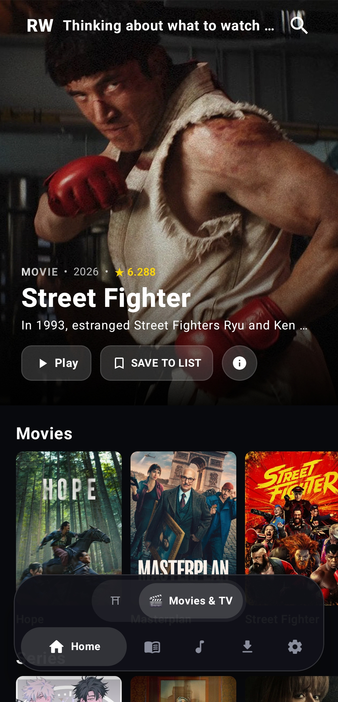

# RAW.
### Your entertainment. One home.

**Discover movies, series, anime, music, manga, and novels in one native Android experience. Explore what you love, find your next favourite, and keep your entertainment together with RAW.**

 

## 🚀 Features

- **🎬 Movies & Series** — Explore movies and shows, discover something new, and enjoy playback in a dedicated viewing experience.
- **⚡ Anime** — Find anime to watch and keep your anime experience together in one place.
- **🎵 Music** — Discover tracks, build playlists, and enjoy a dedicated music player designed for everyday listening.
- **📖 Manga & Reading** — Explore manga and other reading experiences with a dedicated reader interface.
- **📥 Downloads** — Manage supported offline downloads and keep selected content accessible on your device.
- **✨ A Unified Experience** — A cinematic dark interface brings your different entertainment categories together without clutter.

---

## 📱 Screenshots

  <table>
    <tr>
      <td><b>Movies & TV</b></td>
      <td><b>Anime</b></td>
      <td><b>Music Player</b></td>
      <td><b>Manga Reader</b></td>
    </tr>
    <tr>
      <td></td>
      <td></td>
      <td></td>
      <td></td>
    </tr>
  </table>

---

## 📥 Installation

1. Open the [Releases page](https://github.com/prasadshirke206-bit/raw-releases/releases/latest) and download the latest APK.
2. If Android asks, allow installation from this source in your device settings.
3. Install RAW and open the app.

*App availability and features may evolve between releases. Check the release notes for version-specific details.*

---

## ⚖️ Legal Disclaimer

RAW is an independent entertainment application. Names, artwork, and other third-party materials remain the property of their respective owners. Content availability may depend on third-party services and can change over time. RAW does not imply affiliation with or endorsement by third-party rights holders. Users are responsible for ensuring that their use of the application complies with applicable laws and any relevant service terms.
