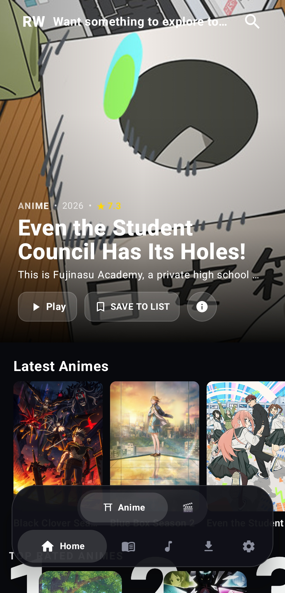
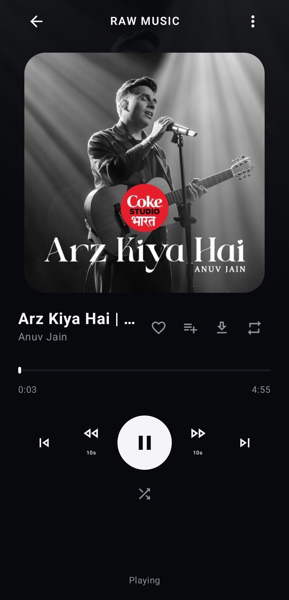
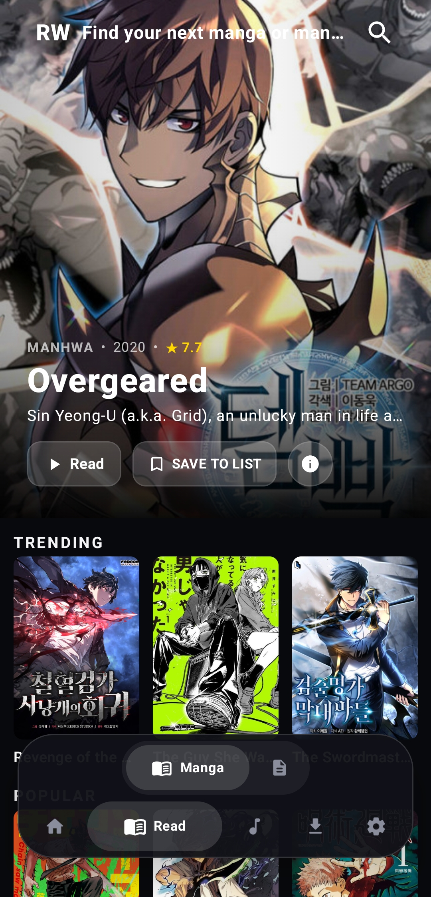

# RAW. 
### Stream without boundaries.

**A native Android engine combining TMDB metadata with advanced web scraping. Movies, anime, and high-fidelity audio in one clean interface.**

 

## 🚀 Features

* **🎬 Cinematic Experience. Everywhere.** - Bypass browser clutter with direct HLS streams. Browse massive TMDB catalogs, track your Anime, and cast directly from our native player.
* **🎵 High-Fidelity Audio.** - Stream 320kbps lossless music natively. Bypass standard DRM protocols, build your perfect playlists, and take your entire library offline.
* **📖 Read Without Limits.** - Integrated MangaDex APIs for the highest quality encodes. Plus, a powerful multi-threaded download engine to save everything directly to your device.
* **⚡ Native Jetpack Compose UI** - No webviews. Pure, hardware-accelerated Android performance.

---

## 📱 Screenshots

  <table>
    <tr>
      <td><b>Movies & TV</b></td>
      <td><b>Anime Menu</b></td>
      <td><b>Lossless Music</b></td>
      <td><b>Manga Reader</b></td>
    </tr>
    <tr>
      <td></td>
      <td></td>
      <td></td>
      <td></td>
    </tr>
  </table>

---

## 📥 Installation

1. Download the latest `app-release.apk` from the [Releases Tab](https://github.com/prasadshirke206-bit/raw-releases/releases).
2. If prompted, allow **"Install from Unknown Sources"** in your Android settings.
3. Install the APK and enjoy. 
*(Updates are managed automatically over-the-air via the app's internal updater).*

---

## ⚖️ Legal Disclaimer

RAW is an open-source media aggregator and advanced web scraper. We do not host, upload, own, or store any copyrighted videos, movies, manga, or audio files on our servers. All content is indexed dynamically and accessed directly from third-party websites and publicly available APIs. RAW is not responsible for the content, accuracy, or legality of the materials provided by these third-party services. The use of this software is strictly at your own risk.
